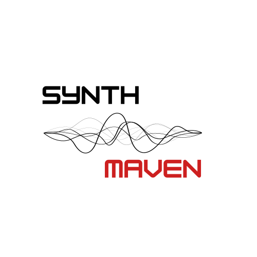

# SynthMaven for M-VAVE FM-1



SynthMaven is an open-source firmware based on [Clipper](https://github.com/isod89/clipper-fm1), with the SLOOP and Felucca foundations credited in the retained licence notices. It adds a four-patch hardware browser, explicit Load/Edit actions and MIDI input routing. The supplied SynthMaven artwork is used on the device splash and web editor/installer. Original copyright holders and licences are retained.

[Web installer](https://kingxeryus.github.io/SynthMaven/webapp/installer/) · [Web editor](https://kingxeryus.github.io/SynthMaven/webapp/editor/) · [Build status](https://github.com/KingXeryus/SynthMaven/actions)

## Development status

**Development firmware; hardware validation is outstanding.** Native BLE builds include MIDI pedal discovery, explicit device selection, connection and disconnect controls. Original Chocolate and Chocolate Plus pairing, reconnect and audio timing still need testing on the FM1. The public 0.2 package predates this integration.

Native USB host support is not implemented. Selecting USB input means device-mode MIDI from a host; a USB keyboard or USB pedal cannot connect directly using a power bank alone. TRS keyboard plus BLE pedal is the intended computer-free combination.

CI must build a real SynthMaven target package and pass the enforced memory bounds before deploying the installer. It never substitutes an upstream binary.

## Stock DX7 sounds

The supplied ROM1A bank (32 voices) and ARABESC voice are built into FM6 as F9–F41, alongside the original eight sounds. Select FM6 in the four-patch PRESETS browser, highlight a voice, then Load or Edit. The editor lists the same read-only factory sounds. Existing B1–B27 slots and saved references retain their original parameter IDs. See [stock data](assets/fm6/README.md).

## Default Korg compatibility sounds

Nine supplied minilogue xd programs append to the HYBRID factory list as XD presets, with a dedicated XD browser category. In the editor, select HYBRID and choose an XD sound from the main preset list to load its patch and amplitude envelope together. The Minilogue XD panel imports `.mnlgxdprog` and selects individual `.mnlgxdlib` programs. Custom `.mnlgxdunit` files are inspected only; their ARM binaries cannot run on the FM1. These are native approximations, with digital oscillator substitutions and compatibility notes. See [the preset list and mappings](docs/KORG.md).

All 23 synth engines remain. Lossless wavetable compression and memory reuse make room for the BLE runtime. See [Bluetooth integration status](docs/BLUETOOTH_STATUS.md) for validation limits.

## Hardware controls

Tap SAVE to PRESETS. Four names are visible per page (fewer in a short final page).

| Control | Action |
|---|---|
| KNOB 1 / PRESETS | Move highlight without loading |
| KNOB 2 / ALGORITHM | Filter by engine or USER |
| KNOB 3 clockwise | Load highlighted patch |
| KNOB 4 clockwise | Load patch and open EDIT macro pages |

This replaces the synth browser's FAV knob action; existing favourites are retained. HOME browsing and groovebox mode retain their original operation. The web editor provides a matching four-patch user-preset browser with Load/Edit actions. Full DX7 operator editing remains in the web FM6 panel.

## MIDI settings

GLO > PATCH MIDI: PROG enables/disables patch switching. PORT depends on PROG. USB selects USB input; BLE selects the native BLE pedal input when the radio runtime is present; ANY preserves legacy routing.

GLO > KEY MIDI: KEY IN selects USB, TRS or BOTH. USB in this build needs an external host. Note-offs from the previous input are still processed after changing source, to avoid hanging notes.

GLO > BLUETOOTH: enable BT MIDI, start SCAN, select PEDAL, then use LINK to connect. A connected link can be disconnected with LINK. Only MIDI READY means service discovery/subscription has completed. The editor provides the same discovery, selection and link status. Original Chocolate and Chocolate Plus remain untested; non-radio builds disable unavailable controls.

Routing preferences persist in a separately checksummed extension of the existing settings side record. Existing compatible settings keep their existing layout. Firmware protocol v15 commands are documented in [MIDI protocol](docs/SYNTHMAVEN_MIDI.md). Editor settings require SynthMaven v15 and refuse older firmware.

For stable pedal addressing, send Bank Select MSB (CC0) 127 and Program Change data 0 for U01, 1 for U02, etc. Empty/out-of-range slots do not change the sound. Each input port and MIDI channel holds independent bank selection. Factory-list bank mappings remain supported. Saved FM6 bank patches need user presets referencing them to use this user-slot addressing.

## Building and verification

See [BUILDING.md](BUILDING.md) for the JieLi pi32v2 toolchain and AC79 SDK. Linux x86-64 runs the target compiler directly; macOS requires Docker. Native BLE target builds use `SYNTHMAVEN_BLE=1 sh build.sh`; the internal package remains `build/felucca.fwsc` for loader compatibility. The product name reported to USB and the UI is SynthMaven.

```
pip install Pillow
sh tools/test_synthmaven.sh
python3 tools/make_synthmaven_site.py
# After a successful target build:
python3 tools/make_synthmaven_site.py --package build/felucca.fwsc
```

Serve `build/synthmaven-site` with `python3 -m http.server --directory build/synthmaven-site 8767`. Web MIDI requires Chrome/Edge and HTTPS or localhost. `?mock=1` is a simulated editor device, not a hardware connection.

Host validation covers the browser, separate Load/Edit actions, keyboard source filtering, pedal source filtering, patch switching off, settings round-trip/CRC/legacy handling, USB/TRS MIDI parsing, editor protocol and installer mock transfers. Real radio pairing, direct USB-host operation, timing and audio under wireless load are unverified. Back up the current device before any firmware installation.

## Credits and licence

GPL-3.0-only unless stated otherwise in the retained notices. Upstream work by isod89/3dSam, SLOOP, and Felucca by Leo Kuroshita / Hügelton Instruments provides the foundation. See [LICENSE](LICENSE), [LICENSING.md](LICENSING.md). M-VAVE/FM-1 are their respective owners' trademarks. The supplied SynthMaven logo is branding, separate from third-party code notices.
