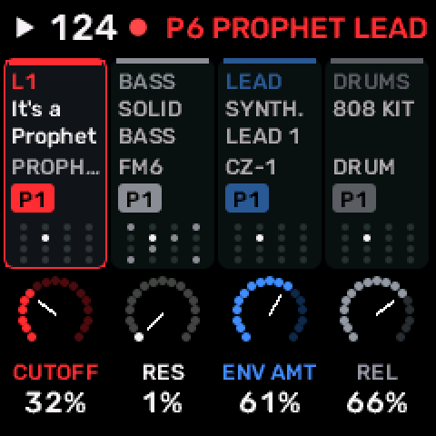
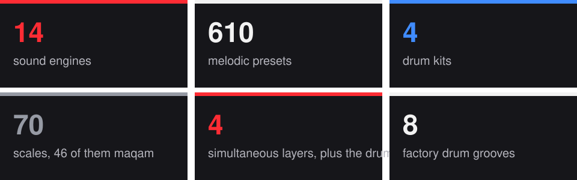
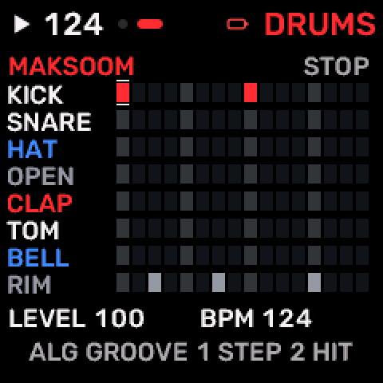
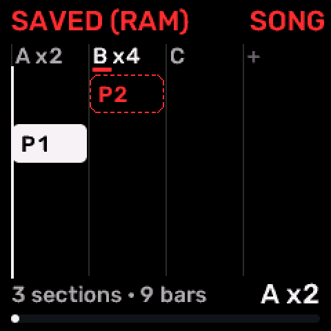
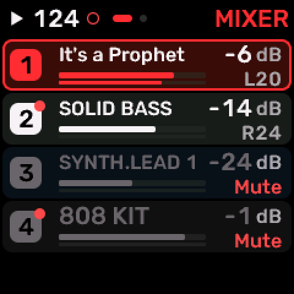

<table><tr><td></td><td>

# SynthMaven 4

**An FM-1 firmware for oriental live musicians, turning the standard M-VAVE FM-1 into an oriental groove box.**

Maqam tuning, layered keys, drums and a sequencer, ready for the stage.

**[Install](https://kingxeryus.github.io/SynthMaven/webapp/installer/)** · [Web editor](https://kingxeryus.github.io/SynthMaven/webapp/editor/) · [Illustrated guide](https://kingxeryus.github.io/SynthMaven/webapp/manual/) · [Release notes](docs/RELEASE_4.1.md)

</td></tr></table>

  

## What makes it an oriental groove box

- **Microtuning for maqam:** 46 maqam settings, a selectable root and octave boundary, and custom offsets per key. Tune from the panel in 10-cent steps, or from the editors in 1-cent steps. Notes below the boundary can stay in equal temperament, each part can bypass the tuning, and chords follow the scale.
- **Multi-layer key mapping:** four parts per program, stacked or split across the keyboard with their own ranges, levels and pans. Hold GLO for two seconds to bring the layers in or out.
- **Groove box:** an independent eight-lane drum machine alongside all four parts, with factory grooves for Maksoom, Wahda, Baladi and Fox as well as Ballad, Half Pipe, Straight 8 and On the Floor.
- **Sequencer:** patterns of up to 64 steps with their own length and division on each track, 8 patterns per track, song arrangement, live recording, step chance, accents, slides, knob automation and a piano roll.
- **Song arranger:** build a whole song from up to 16 sections, each choosing a pattern for every track, a drum groove and repeating 1–16 times, on the FM-1 or in the editors. Or just jam and hold REC to turn what you played into the arrangement.
- **MainStage-style performance:** programs with four scenes each, a 32-entry setlist, and up to 16 learned pedal or controller actions for moving through a show. The web editor and the SM FM1 iPad app share a Perform screen with program and scene navigation, and a mixer, with tuning a tap away on its own Tuning tab.
- **Multi-keyboard support:** give each layer and the drummer its own MIDI input and channel, over USB, TRS or both, so several keyboards can play different layers. The web editor can forward several controllers at once; the iPad app forwards one at a time. Direct pedals and controllers need a powered host adapter or hub.
- **The sounds to match:** HYBRID, DX7/FM6, Prophet-5, CZ-1, SID and classic engines, with hundreds of presets to start from, plus 27 punch effects for live moments.

## Also included

- **Device preferences:** ten named GLO pages, including four themes (SynthMaven, Orange, Baby Blue and Pink), USB role, autosave, controls and recording settings.
- **Factory programs:** DX7 E.Piano, DX Rhodes, Juno 106, E. Organ, Disco Lead, Prophet Lead, Retro Synth and Orchestra.
- **USB:** class-compliant audio and MIDI, recognised by computers as SynthMaven FM1. Set USB ROLE to COMPUTER for editing.
- **Foundations:** built on Melodee 1.5.1, keeping its graphic menus, sequencer, USB audio and native instrument editors. HYBRID imports Vital presets as explicit approximations; it isn't the Vital DSP engine.

## Installation and limitations

Back up before installing: **every firmware flash resets user settings and programs**. Version 3.5 introduced a new storage format, which 4.1 keeps. Keep older whole-device backups for rollback with the matching firmware; do not restore a 3.0 binary backup into 3.5 or later.

This release is **USB-only**. Bluetooth adaptation is a separate experiment and will not be promoted without audio and timing validation. Four parts share CPU, memory and voice resources; they do not each receive an independent guaranteed voice budget. Factory backing parts use lighter mono voices to retain timing headroom. USB capture follows the physical MASTER control.

Use Chrome or Edge for Web MIDI installation/editing. The iOS app uses Apple's native CoreMIDI transport and the same editor. Controller-specific compatibility depends on the selected controller mode; automatic identity matching is not a guarantee for every model.

See [BUILDING.md](BUILDING.md) for building and recovery. Release firmware must come from the attested [FM-1 shared builder](https://github.com/zvenson/fm1-build), with all four recovery archives and checksums verified before publication. Provenance and hardware validation are separate checks.

## Credits and licence

Based on [Melodee](https://github.com/keremimo/melodee), by Kerem Kilic (Ellic Studio), pinned to 6a608ba122ac42293908d394e26713e31ec52fb0; Melodee is based on [Felucca](https://github.com/hugelton/Felucca), by Leo Kuroshita (@kurogedelic), Hügelton Instruments. SynthMaven retains applicable Clipper/3dSam-derived work and upstream third-party notices. See [LICENSING.md](LICENSING.md), [LICENSE](LICENSE) and LICENSES for details. Not affiliated with or endorsed by M-VAVE or the upstream authors. Report this build's issues to SynthMaven.

## Retained engines and space budget

Version 4 retains DX7/FM6, HYBRID/Vital translations, ANALOG, DIGITAL, VOICE, STRINGS, JUNO, ACID, VPS and WSEQ alongside the Melodee native engines. ACID/VPS/WSEQ add 42 presets. FMX, VECTOR, TERRAIN, WAVE and MACRO are excluded. WSEQ retains its sequences and crossfades with compact oscillator waveforms; it is not a bit-identical port of the older FMX-table oscillator. Four layers and independent drums remain available. The startup icon is losslessly packed without reducing resolution.

The shared editors include named custom-scale saving, compatible Scala import/export, modulation templates, engine-aware filter controls, two-card sound editing and paged Effects/LFO/ARP controls. Output compensation and Bluetooth are excluded. See the illustrated guide for direct USB host and powered-hub wiring, and the separate computer/iPad-hosted editing setup.
